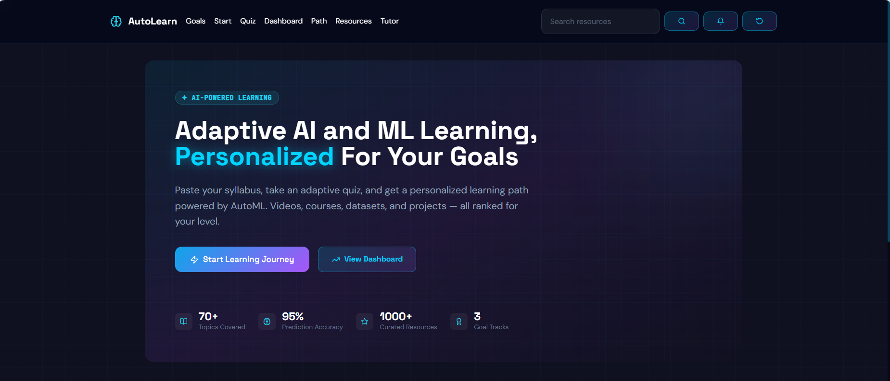
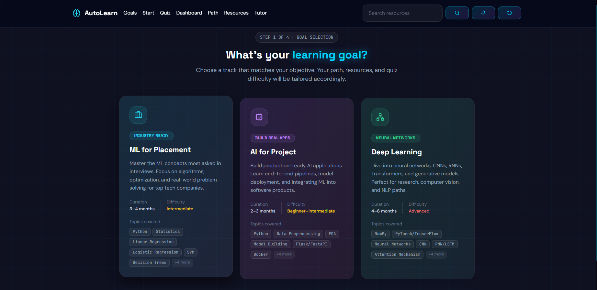
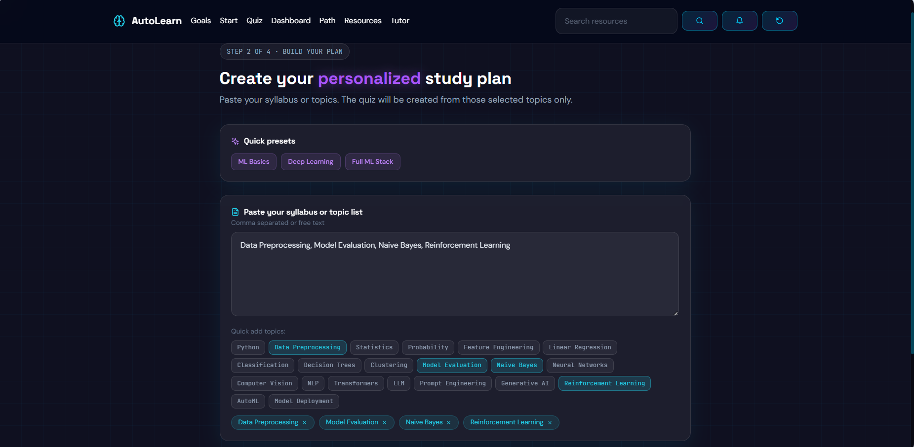
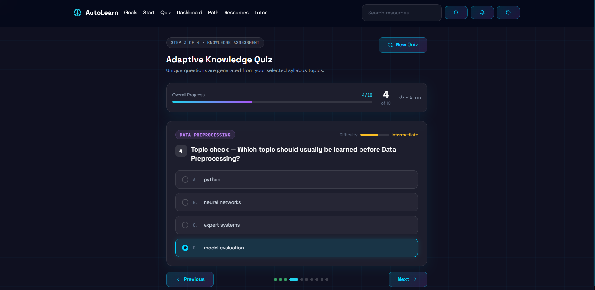
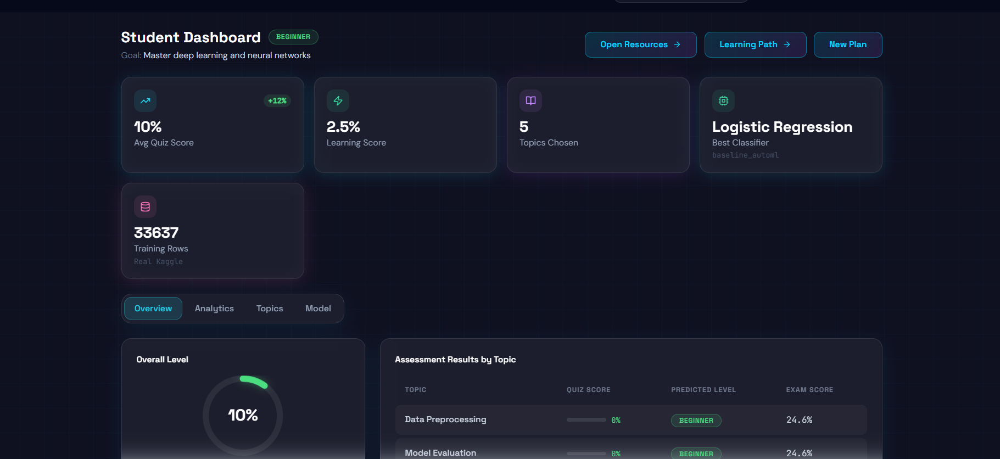
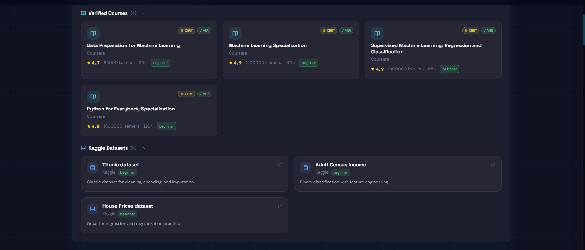
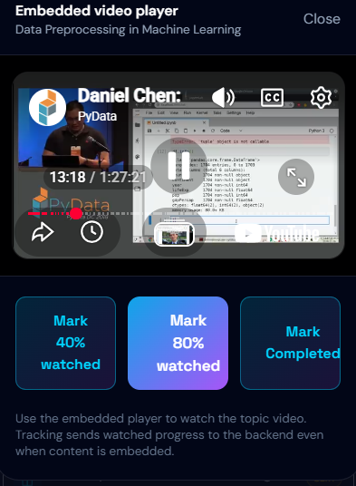
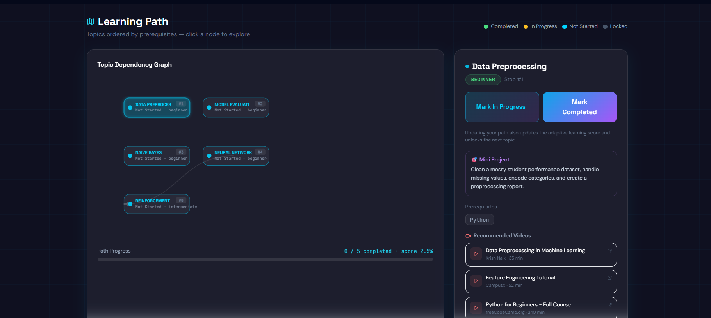
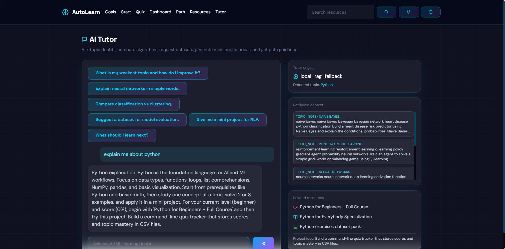

# AutoLearn KT-RL: Knowledge-Tracing-Guided Reinforcement Learning for Personalized Exercise Selection

[](https://github.com/Sanjayt215/AI-ML-Adaptive-Learning-Platform/actions/workflows/ci.yml)
[](tests/)
[](https://www.python.org/)
[](https://react.dev/)
[](LICENSE)

**AutoLearn KT-RL** is a full-stack, pedagogical AI platform that unites **Bayesian Knowledge Tracing (BKT)**, **Reinforcement Learning (Dueling Double DQN)**, and **Multi-Modal Assessment Intelligence** to deliver truly personalized exercise selection, prerequisite-aware remediation, and spaced retention.

---

## 🌟 Key Capabilities & Research Features

- **Bayesian Knowledge Tracing (BKT):**
  - Continuous posterior tracking across 30 syllabus Knowledge Components (KCs).
  - Exact formulation with parameter boundaries: $P(L_0)$, $P(T)$, $P(S)$, and $P(G)$ satisfying identifiability constraints ($P(G) + P(S) < 1.0$).
  - Full event replay engine backed by persistent SQLite storage (`learning_events` and `learning_sessions`).

- **Dueling Double DQN Recommendation Agent:**
  - **Gymnasium Environment (`ExerciseSelectionEnv`):** 99-dimensional observation space encoding BKT mastery posteriors, recent interaction history, failure counts, and time elapsed.
  - **Action Space:** 52 discrete canonical exercise items with topological prerequisite action masking.
  - **Multi-Objective Reward Formulation:** Balances learning gain ($R_{\text{gain}}$), information gain ($R_{\text{info}}$), Zone of Proximal Development matching ($R_{\text{match}}$), and consecutive failure penalties ($R_{\text{penalty}}$).
  - **Safety & Shadow Mode:** Runs with fallback recovery controllers to prevent negative spiral feedback loops during live student interactions.

- **Unified Multi-Modal Assessment Intelligence:**
  - 8 distinct diagnostic modalities: Diagnostic MCQs, Concept Explanations (rubric-scored), Code Sandbox, Knowledge Graphs, Metacognitive Calibration, Project-Based Rubrics, Spaced Flashcards, and Behavioral Telemetry.
  - 6-axis uncollapsed mastery radar and per-KC evidence matrix.

- **Four Differentiated Student Workflows:**
  1. *Continue Learning:* Curriculum DAG frontier progression.
  2. *Improve Weak Topics:* Targeted remediation for KCs with $P(L) < 0.70$.
  3. *Exam Preparation:* Timed mock exams with syllabus readiness forecasting.
  4. *Revision Center:* Spaced retrieval with exponential half-life forgetting decay: $R(t) = 2^{-\Delta t / S}$.

- **Streamlined 7-Hub Navigation:**
  - Intuitive student experience across `/learn`, `/learning-plan`, `/assessments`, `/ai-tutor`, `/my-progress`, `/resources`, and a dedicated `/research/rl-intelligence` laboratory.

---

## 📸 Screenshots

### 1. Dashboard Overview & Multi-Method Radar


### 2. Goal Selection & Onboarding


### 3. Study Plan Builder & Topological DAG


### 4. Adaptive Diagnostic Quiz


### 5. Multi-Method Assessment Results


### 6. Curated Courses & Datasets


### 7. Video Progress Tracking


### 8. Prerequisite-Aware Learning Path


### 9. AI Tutor with Local RAG Fallback


---

## 🛠️ Architecture & Tech Stack

```text
├── frontend/                  # React 18 SPA (Tailwind CSS, Lucide, Recharts)
│   ├── src/components/        # Reusable UI widgets & PersonalizedLearningJourney
│   └── src/pages/             # 7-Hub architecture & Research Mode pages
├── services/                  # Core AI/ML/RL Engine
│   ├── bkt_service.py         # Bayesian Knowledge Tracing mathematical engine
│   ├── dqn_agent.py           # Dueling Double DQN architecture & replay buffer
│   ├── rl_env.py              # Gymnasium exercise selection environment
│   ├── rl_reward.py           # Multi-objective composite reward function
│   ├── recovery_controller.py # Anti-frustration & prerequisite backoff controller
│   ├── learner_store.py       # SQLite persistence for sessions & interaction events
│   ├── learner_simulator.py   # Synthetic learner archetypes for policy evaluation
│   └── spaced_repetition.py   # Half-life forgetting curve & review scheduling
├── tests/                     # 153 Comprehensive Unit & Integration Tests
├── docs/                      # Full architectural and mathematical documentation
├── app.py                     # Flask REST API server with session auto-seeding
└── resources.py               # 52 Curated items, 30 KCs, and topic graph catalogs
```

---

## 🚀 Quick Start Guide

### Prerequisites
- Python 3.10+
- Node.js 18+ and npm

### 1. Automated Launch (Windows)
```cmd
start_project.bat
```

### 2. Manual Setup

#### Backend (Flask API)
```bash
# Set up Python virtual environment
python -m venv .venv
source .venv/bin/activate  # On Windows: .venv\Scripts\activate

# Install dependencies
pip install -r requirements.txt

# Run backend on port 5001
python app.py
```

#### Frontend (React)
```bash
cd frontend
npm install
npm start
```
Open **[http://localhost:3000](http://localhost:3000)** in your browser.

---

## 🧪 Testing & Verification

Run the full automated test suite (153 unit & integration tests covering BKT, Dueling DQN, Gymnasium environments, action masking, and workflow routing):

```bash
python -m unittest discover -s tests -p "test_*.py"
```

To run individual service tests:
```bash
python -m unittest tests/test_bkt_service.py
python -m unittest tests/test_four_distinct_workflows.py
python -m unittest tests/test_rl_intelligence_api.py
```

---

## 📚 Documentation

Detailed specifications and mathematical derivations are available in the [`docs/`](docs/) directory:
- [`docs/kt_rl_architecture.md`](docs/kt_rl_architecture.md) — System architecture, observation encoding, and data pipelines.
- [`docs/bkt_model_and_parameters.md`](docs/bkt_model_and_parameters.md) — Bayesian Knowledge Tracing equations and parameter tables.
- [`docs/learner_simulator_and_rl_environment.md`](docs/learner_simulator_and_rl_environment.md) — Gymnasium environment and learner archetypes.
- [`docs/learning_event_data_dictionary.md`](docs/learning_event_data_dictionary.md) — SQLite schema and telemetry field definitions.

---

## 📄 License

This project is licensed under the MIT License — see the [LICENSE](LICENSE) file for details.
