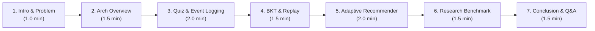

# AutoLearn KT-RL Academic Demonstration Script (8–12 Minutes)

**Research Project:** Knowledge-Tracing-Guided Reinforcement Learning for Personalized Exercise Selection  
**Presenters / Researchers:** T. Sanjay (E0124009), M. Nithish Kumar (E0124027)  
**Target Audience:** Academic Examiners, Project Reviewers & Evaluators  
**Duration:** 10 Minutes + Q&A  

---

## Demonstration Timeline & Step-by-Step Walkthrough



---

### Step 1: Research Problem & Objective (1:00)
- **Speaker Action:** Introduce the research context.
- **Key Talking Points:**
  - Traditional online learning platforms present static or rigid exercise sequences, resulting in frustration when exercises are too hard or boredom when they are too easy.
  - Our objective is to combine **Bayesian Knowledge Tracing (BKT)** with **Reinforcement Learning** to dynamically recommend exercises tailored to a student's Zone of Proximal Development (ZPD).
  - We also model **longitudinal forgetting decay**, **posterior uncertainty**, and **frustration risk**.

---

### Step 2: System Architecture Overview (1:30)
- **Speaker Action:** Show the layered architecture diagram in [`docs/kt_rl_architecture.md`](file:///c:/Users/sanja/Downloads/autolearn_llm_ml_upgrade_ready/autolearn_fullstack/docs/kt_rl_architecture.md).
- **Key Talking Points:**
  - 4 clean tiers: Persistent Data Tier (SQLite), Cognitive State Modeling Tier (BKT + Forgetting + Entropy), Offline RL Sandbox (Gymnasium Env + Dueling DQN), and Serving Tier (Flask + React).
  - Explain the 30 Knowledge Components and prerequisite dependency Directed Acyclic Graph (DAG).
  - Highlight the **Production Safety Boundary**: The production quiz flow is never controlled by unverified RL policies.

---

### Step 3: Live Quiz & Atomic Event Persistence (2:00)
- **Speaker Action:** Navigate to the Web Dashboard at `http://localhost:3000` (or `http://localhost:5173`).
- **UI Demonstration:**
  1. Click **Take Quiz** on the dashboard.
  2. Answer a Python question correctly (e.g., variable assignment).
  3. Submit the response.
- **Terminal Verification (Show Live SQLite Event):**
  ```powershell
  python -c "import sqlite3; conn = sqlite3.connect('autolearn_fullstack/learner_events.db'); cur = conn.cursor(); print(cur.execute('SELECT event_id, item_id, correctness, timestamp FROM learning_events ORDER BY id DESC LIMIT 1').fetchone())"
  ```
- **Evidence to Point Out:** Real-time persistence of item ID, timestamp, response time, and correctness.

---

### Step 4: Bayesian Knowledge Tracing & Chronological Replay (1:30)
- **Speaker Action:** Navigate to the **Knowledge Tracing** tab on the Dashboard.
- **UI Demonstration:**
  - Show the topic mastery progress bars. Point out how the answered topic's estimated mastery $P(L)$ increased according to BKT posterior filtering:
    $$P(L_t \mid Y_t = 1) = \frac{P(L_{t-1})(1-P(S))}{P(L_{t-1})(1-P(S)) + (1-P(L_{t-1}))P(G)}$$
  - Unassessed topics are clearly distinguished by a dedicated `not_assessed` status chip.
- **API Call to Show Deterministic Replay:**
  ```powershell
  Invoke-RestMethod -Uri "http://127.0.0.1:5001/api/learning/mastery/learner_default/replay" -Method POST
  ```
- **Evidence to Point Out:** Replaying past events from scratch produces an exact match to the live state (error $< 10^{-6}$).

---

### Step 5: Adaptive Next Exercise Recommendation Card (2:00)
- **Speaker Action:** On the Knowledge Tracing tab, focus on the **Adaptive Next Exercise Recommendation Card**.
- **UI Features to Demonstrate:**
  1. **Topic & Difficulty Pill:** Explains the selected exercise item.
  2. **Pedagogical Rationale:** Real-time textual explanation (e.g., *"Recommended because mastery on syntax_variables is 0.42 (ZPD target) with high uncertainty (entropy: 0.98)"*).
  3. **Cognitive State Gauges:**
     - **Topic Mastery:** BKT probability $P(K)$.
     - **Predicted Retention:** $R(t)$ accounting for exponential forgetting decay ($m_{\text{floor}} = 0.10$).
     - **Evidence Confidence:** Low/Medium/High derived from Shannon entropy $H(p)$.
     - **Frustration Risk:** Low/Elevated/High detecting consecutive failure streaks ($\ge 2$).
  4. **Action Button:** "Take Adaptive Practice Quiz" opens the quiz with the recommended item pre-selected.

---

### Step 6: Prerequisite Action Masking & DQN Boundary (1:30)
- **Speaker Action:** Open terminal to explain the RL policy and why action masking is essential.
- **Key Talking Points:**
  - Prerequisite masking overrides invalid question logits with $-10^9$.
  - In our ablation study, unmasked selection caused **93 curriculum prerequisite violations**, while masked selection resulted in **0 violations**.
  - Show the safety feature gate:
    ```powershell
    Invoke-RestMethod -Uri "http://127.0.0.1:5001/api/experimental/recommendation" -Method POST
    ```
    *Highlight that because `KT_RL_EXPERIMENT_ENABLED=0`, the system automatically falls back to `prereq_aware_weakest_baseline` with `experimental_flag_active: false`.*

---

### Step 7: Research Benchmark Results & Viva Conclusion (1:30)
- **Speaker Action:** Display the benchmark results from [`reports/phase6_reproducibility_results.json`](file:///c:/Users/sanja/Downloads/autolearn_llm_ml_upgrade_ready/autolearn_fullstack/reports/phase6_reproducibility_results.json).
- **Benchmark Table:**
  | Policy | Cumulative Reward | Net True Mastery Gain | Accuracy | Invalid Actions |
  | :--- | :---: | :---: | :---: | :---: |
  | **Composite Adaptive (Our Policy)** | **36.04** | -0.0275 | 47.4% | **0** |
  | **Prereq-Aware Weakest (Top Baseline)** | 31.48 | **-0.0245** | 50.2% | **0** |
  | **Dueling DQN (Neural Policy)** | 32.23 | -0.0292 | 46.4% | **0** |
  | **Difficulty Ladder** | 11.82 | -0.0587 | 66.2% | **0** |
- **Concluding Defense Statement:**
  - *"Our empirical evaluation demonstrates scientific honesty: while Dueling DQN successfully learned prerequisite constraints and achieved high cumulative reward, it did not outperform the prerequisite-aware heuristic in net true mastery gain. Therefore, in accordance with responsible AI engineering, we kept DQN safely in an offline research sandbox and deployed our composite adaptive policy for production."*
