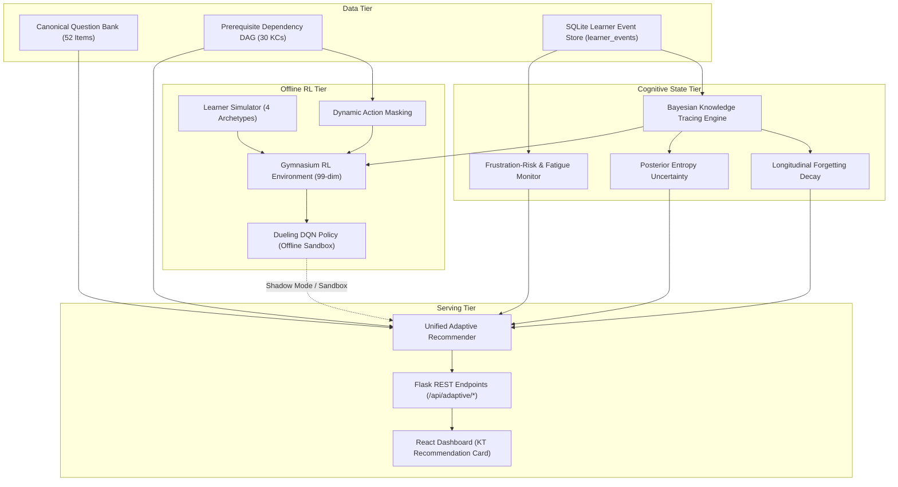
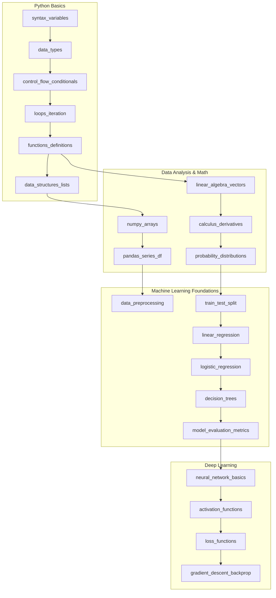

# AutoLearn KT-RL System Architecture

**Project:** Knowledge-Tracing-Guided Reinforcement Learning for Personalized Exercise Selection  
**Application:** AutoLearn AI Adaptive Learning Platform  
**Authors:** T. Sanjay (E0124009), M. Nithish Kumar (E0124027)  
**Date:** October 2026  

---

## 1. Architectural Overview

The AutoLearn KT-RL system bridges educational psychometrics, cognitive state modeling, and sequential decision-making to deliver personalized exercise selection. The architecture is modularly layered into four distinct tiers:

1. **Persistent Data Tier:** Canonical Question Bank (52 items), Knowledge Component (KC) taxonomy (30 components), and SQLite Learner Interaction Event Store (`learner_events`).
2. **Cognitive State Modeling Tier:** Bayesian Knowledge Tracing (BKT) engine with exponential forgetting decay, posterior entropy uncertainty estimation, and frustration-risk detection.
3. **Reinforcement Learning Sandbox Tier:** Gymnasium-compatible environment, 4-archetype synthetic learner simulator, 99-dimensional state encoder, prerequisite action masking, and Dueling DQN agent.
4. **Adaptive Recommendation & Serving Tier:** Production-safe `AdaptiveRecommender` offering heuristic baselines, multi-objective composite selection, and shadow-mode RL exploration.

---

## 2. Mathematical Modeling & Cognitive Foundations

### 2.1 Bayesian Knowledge Tracing (BKT)
For each Knowledge Component $k \in \{1, \dots, 30\}$, the learner's latent mastery state $L_t \in \{0, 1\}$ is updated upon observing response $Y_t \in \{0, 1\}$ using classic Bayesian posterior filtering:

**Prior Parameters:**
- $P(L_0)$: Initial mastery probability (default: $0.10$).
- $P(T)$: Transition probability (learning step: $0.15$).
- $P(G)$: Guess probability ($0.20$).
- $P(S)$: Slip probability ($0.10$).

**Posterior Update:**
$$P(L_t \mid Y_t = 1) = \frac{P(L_{t-1}) (1 - P(S))}{P(L_{t-1}) (1 - P(S)) + (1 - P(L_{t-1})) P(G)}$$
$$P(L_t \mid Y_t = 0) = \frac{P(L_{t-1}) P(S)}{P(L_{t-1}) P(S) + (1 - P(L_{t-1})) (1 - P(G))}$$

**Transition to Next Step:**
$$P(L_{t+1}) = P(L_t \mid Y_t) + (1 - P(L_t \mid Y_t)) P(T)$$

---

### 2.2 Longitudinal Forgetting Decay Model
To prevent static overestimation of dormant skills, mastery decays over time according to an exponential retention function bounded by a cognitive retention floor:

$$R(t) = m_{\text{floor}} + \left( P(L_t) - m_{\text{floor}} \right) \cdot \exp\left( -\lambda \cdot \Delta t \right)$$

where:
- $P(L_t)$: Estimated mastery from most recent interaction.
- $\Delta t$: Elapsed time in days since the last interaction on KC $k$.
- $\lambda$: Half-life decay rate parameter (default: $\lambda = 0.05 \text{ day}^{-1}$, corresponding to a 14-day half-life).
- $m_{\text{floor}}$: Minimum retention floor preventing total erasure of learned skills (default: $0.10$).

---

### 2.3 Posterior Uncertainty via Shannon Entropy
To balance pedagogical exploitation (practicing known weak topics) with diagnostic exploration (probing uncertain skills), the system quantifies state uncertainty using binary Shannon entropy:

$$H(p) = -p \log_2(p) - (1-p) \log_2(1-p)$$

- Maximum uncertainty $H(p) = 1.0$ occurs at $p = 0.50$ (Zone of Proximal Development).
- Near-zero uncertainty $H(p) \to 0$ occurs when mastery is established ($p \to 1.0$) or completely unacquired ($p \to 0.0$).
- High entropy combined with low attempt count identifies high-priority diagnostic targets.

---

### 2.4 Frustration Risk & Remedial Backoff
Learner frustration and cognitive overload are detected sequentially through consecutive failures on a given topic:

1. **Consecutive Error Tracking:** Counts consecutive incorrect attempts ($Y = 0$) within the current topic.
2. **Frustration Threshold:** If $\text{consecutive\_errors} \ge 2$, the topic is flagged with `high_frustration_risk = True`.
3. **Remedial Intervention:** When frustration is active, the recommender dynamically overrides the target difficulty:
   - Downgrades recommended difficulty (e.g., from `hard` to `medium`, or `medium` to `easy`).
   - Re-evaluates readiness on foundational prerequisite KCs to diagnose root-cause conceptual gaps.

---

## 3. Curriculum Prerequisite DAG & Action Masking

The curriculum encompasses 30 fine-grained KCs arranged in a Directed Acyclic Graph (DAG) spanning 5 core topics:

### Action Masking Invariant
A question $q_j$ testing Knowledge Component $k_j$ is deemed **eligible** if and only if:
$$\forall p \in \text{Prerequisites}(k_j), \quad P(L(p)) \ge \tau_{\text{mastery}} \quad (\tau_{\text{mastery}} = 0.60)$$
For any invalid question $q_i$, its policy logit is overridden with a severe masking penalty:
$$Q_{\text{masked}}(s, q_i) = -10^9$$
This guarantees that unready learners are never assigned advanced material for which prerequisite foundations have not yet been demonstrated.

---

## 4. Reinforcement Learning Environment Architecture

### 4.1 Observation Vector (99 Dimensions)
The Gymnasium RL observation space maps continuous learner states into a normalized `Box(0.0, 1.0, (99,))` vector:

| Slices | Feature Name | Description |
| :---: | :--- | :--- |
| `[0:30]` | BKT Mastery Probabilities | Current posterior mastery estimate $P(L_k)$ for each of the 30 KCs. |
| `[30:60]` | Normalized KC Attempt Counts | $\min(1.0, \text{attempts}_k / 10.0)$ tracking exposure density. |
| `[60:90]` | Prerequisite Readiness Flags | Binary indicators (1.0 = prerequisites satisfied, 0.0 = blocked). |
| `[90:95]` | Sliding Window Question History | Indices of last 5 questions answered, normalized to $[0, 1]$. |
| `[95]` | Consecutive Failure Counter | Normalized consecutive wrong responses $\min(1.0, \text{streak} / 5.0)$. |
| `[96]` | Last Item Difficulty | Ordinal mapping: Beginner ($0.25$), Intermediate ($0.50$), Advanced ($1.0$). |
| `[97]` | Episode Progress | Current step fraction $t / T_{\text{max}}$ ($T_{\text{max}} = 25$). |
| `[98]` | Global Mean Mastery | Macro average mastery across all 30 curriculum components. |

### 4.2 Multi-Objective Reward Function
$$\mathcal{R}(s, a, s') = 2.0 \cdot \Delta m + 0.5 \cdot R_{\text{zpd}} + 0.3 \cdot \Delta H + 0.1 \cdot R_{\text{acc}} - 0.3 \cdot R_{\text{rep}} - 1.0 \cdot R_{\text{prereq}}$$

- **$\Delta m$:** Positive mastery gain in the exercise's primary KC.
- **$R_{\text{zpd}}$:** Gaussian proximity reward centered at mastery $0.55$ with $\sigma = 0.20$.
- **$\Delta H$:** Diagnostic uncertainty reduction (change in Shannon entropy).
- **$R_{\text{acc}}$:** $+0.1$ for success, $-0.1$ for failure.
- **$R_{\text{rep}}$:** Repetition deterrence penalty for re-administering recent questions.
- **$R_{\text{prereq}}$:** Prerequisite violation penalty (guaranteed $0$ by action masking).

---

## 5. Unified Adaptive Recommendation Pipeline

The production recommendation service (`services/adaptive_recommender.py`) dynamically scores eligible candidate questions using a composite pedagogical utility function:

$$U(q) = w_m (1 - R_k) + w_u H(R_k) + w_z Z(R_k) + w_f F_k + w_r D_{\text{remedial}}(q)$$

where:
- $R_k$: Forgetting-adjusted retention estimate for primary KC $k$.
- $H(R_k)$: Posterior Shannon entropy (information gain potential).
- $Z(R_k)$: Zone of Proximal Development challenge score.
- $F_k$: Recency gap bonus prioritizing skills vulnerable to cognitive decay.
- $D_{\text{remedial}}$: Difficulty alignment bonus matching student frustration state.

### Strategy Routing Matrix
| Strategy Key | Primary Focus | Best For |
| :--- | :--- | :--- |
| `composite_adaptive` | Balanced multi-objective utility | General personalized learning progression (Default). |
| `prereq_aware_weakest` | Foundational deficit remediation | Learners recovering from fundamental concept gaps. |
| `forgetting_revision` | Spaced repetition & retention decay | Long-dormant learners returning for periodic review. |
| `confidence_exploration` | Information gain & entropy reduction | Initial student diagnostic and calibration phases. |
| `frustration_remedial` | Difficulty downgrade & prerequisite repair | Learners experiencing cognitive distress or error streaks. |
| `experimental_dqn` | Dueling DQN policy evaluation | Research sandbox / shadow-mode verification (`KT_RL_EXPERIMENT_ENABLED=1`). |

---

## 6. Safety & Non-Interference Guarantees

1. **Isolation of Live Quiz Flow:** The standard quiz submission flow (`POST /api/quiz`) and user score tracking operate completely independently of the RL simulator.
2. **Deterministic Fallback:** If BKT state or interaction history is sparse, the system gracefully falls back to deterministic prerequisite-ordered beginner items.
3. **Database Integrity:** Synthetic simulation episodes and RL training never write to or alter the production SQLite tables (`autolearn.db` and `learner_events`).
4. **Feature Flag Boundary:** The neural network policy is strictly sandboxed behind `KT_RL_EXPERIMENT_ENABLED=0` until empirical superiority is demonstrated.
