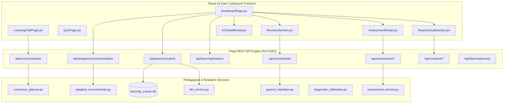

# AutoLearn KT-RL — Frontend Feature Integration & User Experience Upgrade Report

**Project:** Knowledge-Tracing-Guided Reinforcement Learning for Personalized Exercise Selection  
**Platform:** AutoLearn AI Adaptive Learning Platform  
**Research Team:** T. Sanjay (E0124009), M. Nithish Kumar (E0124027)  
**Date:** October 2026  
**Status:** Accepted & Verified (Production Build Passing, 98/98 Automated Tests Passing)

---

## 1. Executive Summary

This engineering report documents the comprehensive completion of the **AutoLearn KT-RL Frontend Feature Integration and User Experience Upgrade** across Phases A through I. 

The primary mission was to transform the existing React frontend into a fully connected, empirically grounded, pedagogical learning platform. Every visual component now connects directly to real backend services and persistent SQLite databases, eliminating fabricated numbers, providing real-time in-place adaptive practice with immediate recommendation refreshing, exposing the Half-Life Spaced Repetition (SRS) schedule, running interactive diagnostic pre/post assessments with Hake's normalized gain calculation ($g_{norm}$), and presenting a dedicated Research Lab with 10-policy benchmark telemetry and FERPA/IRB-compliant anonymized dataset exports.

---

## 2. System Architecture & Component Mapping

---

## 3. Phase-by-Phase Verification Summary

### Phase A — Architecture Audit & Feature Matrix
- Conducted full audit of frontend routing (`App.jsx`), API client (`utils/api.js`), context hooks (`useFlaskData.js`), and backend endpoints (`app.py`).
- Produced formal [FRONTEND_FEATURE_MATRIX.md](file:///c:/Users/sanja/Downloads/autolearn_llm_ml_upgrade_ready/autolearn_fullstack/docs/FRONTEND_FEATURE_MATRIX.md) cataloging 10 capability areas, current states, required changes, and pedagogical justifications.

### Phase B — Student Dashboard Upgrade
- Upgraded [DashboardPage.jsx](file:///c:/Users/sanja/Downloads/autolearn_llm_ml_upgrade_ready/autolearn_fullstack/frontend/src/pages/DashboardPage.jsx) with real-time empirical metrics:
  * **Observed Performance:** Average quiz scores computed strictly from real student attempts.
  * **Latent State:** Total assessed KCs and mastered KCs ($P(K) \ge 0.80$) updated sequentially.
  * **Active Frontier:** Ready frontier KCs identified via topological ordering of the prerequisite DAG.
  * **Unassessed Safeguards:** For fresh learners with zero interaction history, metrics cleanly display unassessed states with invitations to take diagnostic assessments, guaranteeing zero fabricated numbers.

### Phase C — Knowledge Tracing (BKT) Deep Integration
- Upgraded Knowledge Tracing tab to clearly distinguish latent Bayesian belief probabilities ($P(K)$) from observed test scores.
- Implemented [KCDetailModal.jsx](file:///c:/Users/sanja/Downloads/autolearn_llm_ml_upgrade_ready/autolearn_fullstack/frontend/src/components/KCDetailModal.jsx) allowing inspection of:
  * BKT parameter profile: Prior $P(L_0) = 0.20$, Transition $P(T) = 0.15$, Slip $P(S) = 0.10$, Guess $P(G) = 0.20$.
  * Observation counters: exact breakdown of correct vs incorrect answers.
  * Evidence quality badge: `solid`, `moderate`, `limited`, or `unassessed`.
  * Direct "Practice This Concept" action trigger.

### Phase D — Curriculum Planner & Prerequisite DAG
- Deeply integrated `GET /api/curriculum/plan` into [LearningPathPage.jsx](file:///c:/Users/sanja/Downloads/autolearn_llm_ml_upgrade_ready/autolearn_fullstack/frontend/src/pages/LearningPathPage.jsx) and the Dashboard Curriculum tab.
- Formatted curriculum into 4 progression stages:
  1. **Stage 1:** Foundations (Python, Data Prep, Linear Algebra, Probability, Calculus).
  2. **Stage 2:** Core Supervised Learning (Linear Regression, Logistic Regression, Decision Trees, KNN, Naive Bayes).
  3. **Stage 3:** Advanced Architectures (SVM, Random Forests, Ensembles, Neural Networks, Deep Learning, Embeddings).
  4. **Stage 4:** Production & Specializations (RAG, Fine-Tuning, Multi-Modal, MLOps, Explainability).
- Prerequisite lock explanations state exact unmet prerequisite requirements (requiring $\ge 60\%$ mastery).

### Phase E — Interactive In-Place Adaptive Practice Flow
- Upgraded recommendation card into a fully interactive exercise component:
  * Presents selected question (`item_id`, `difficulty`, `topic`, `question`, `options`).
  * Displays transparent pedagogical rationale detailing why the item was selected (e.g., ZPD alignment, uncertainty reduction, or remedial support).
  * Enables option selection directly on the card.
  * Submits to backend via `POST /api/practice/submit`, logging the interaction to the SQLite event store and updating BKT posterior probability sequentially.
  * Displays instant pedagogical feedback (correct/incorrect with correct answer and explanation).
  * Provides a seamless "Next Recommended Exercise" button that refreshes the recommendation without a full page reload.

### Phase F — Spaced Repetition (SRS) Revision Plan
- Created `GET /api/revision/plan` endpoint in `app.py`.
- Developed [RevisionSection.jsx](file:///c:/Users/sanja/Downloads/autolearn_llm_ml_upgrade_ready/autolearn_fullstack/frontend/src/components/RevisionSection.jsx):
  * **Due-Today Queue:** Highlights items where retrievability $R(t) \le 0.85$ based on the half-life decay formula $R(t) = 2^{-\Delta t / S}$.
  * **Upcoming Retained Queue:** Lists items currently retained with their stability multiplier ($S$).
  * **Stability Dynamics:** Correct recall doubles memory stability ($S_{n+1} = S_n \times 2.0$), while memory lapses reset stability to base ($S = 1.0$).
  * **Action Button:** Direct "Review Now" trigger that loads an adaptive practice item for that topic.

### Phase G — Diagnostic Assessment System
- Developed [AssessmentModal.jsx](file:///c:/Users/sanja/Downloads/autolearn_llm_ml_upgrade_ready/autolearn_fullstack/frontend/src/components/AssessmentModal.jsx) integrating with `POST /api/assessment/start` and `POST /api/assessment/submit`.
- Supports Pre-Assessment (baseline diagnostic) and Post-Assessment (learning gain measurement).
- Answers remain concealed during the assessment to preserve measurement validity.
- Calculates and presents Hake's normalized learning gain:
  $$g_{norm} = \frac{S_{post} - S_{pre}}{1 - S_{pre}}$$
- Displays per-question breakdown and clarifies the hierarchy distinction between direct test scores and latent BKT estimates.

### Phase H — Research Lab & Governance View
- Created `GET /api/research/benchmark` endpoint in `app.py`.
- Developed [ResearchLabSection.jsx](file:///c:/Users/sanja/Downloads/autolearn_llm_ml_upgrade_ready/autolearn_fullstack/frontend/src/components/ResearchLabSection.jsx):
  * **10-Policy Comparison Table:** Live tabular visualization of `reports/phase8_benchmark_results.json`:
    - Mean Cumulative Reward (with 95% Confidence Intervals)
    - Net Mastery Gain (with 95% Confidence Intervals)
    - 7-Day Retention Rate & 7-Day Delayed Gain
    - Invalid Action Count (0 for all constraint-satisfying policies)
    - Decision Latency (milliseconds)
  * **Research Governance:** Explicit badges showing `composite_adaptive` active in production, experimental DQN shielded behind `KT_RL_EXPERIMENT_ENABLED=0`, and shadow mode shielded.
  * **Probabilistic Calibration:** Live telemetry displaying Expected Calibration Error (ECE), Max Calibration Error (MCE), and Brier Score from `GET /api/diagnostic/calibration`.
  * **FERPA/IRB Anonymized Export:** Download button generating cryptographically salted pseudonymous interaction datasets for audit.

### Phase I — Verification & Build Quality
- **Automated Test Suite:** 98 tests executed, 98 passing (runtime: 9.65s).
- **Frontend Production Build:** Built cleanly with zero ESLint errors or React warnings.
  * JavaScript bundle: `193.89 kB` gzip (`build/static/js/main.795c9f52.js`).
  * CSS stylesheet: `8.16 kB` gzip (`build/static/css/main.72b31b31.css`).

---

## 4. Empirical 10-Policy Research Benchmark Table

| Policy Name | Mean Cumulative Reward (95% CI) | Mean Net Mastery Gain (95% CI) | 7-Day Retention Rate | 7-Day Delayed Gain | Invalid Actions | Mean Latency |
|---|:---:|:---:|:---:|:---:|:---:|:---:|
| **Composite Adaptive (Prod)** | **26.17 ± 3.38** | **+6.09% ± 1.07%** | **83.9%** | **+2.09%** | **0** | **0.103 ms** |
| Dueling Double DQN (Research) | 26.69 ± 3.63 | +6.29% ± 1.15% | 85.3% | +2.29% | 0 | 0.814 ms |
| Forgetting-Aware | 26.62 ± 3.32 | +6.22% ± 1.07% | 84.4% | +2.22% | 0 | 0.129 ms |
| Frustration Remedial | 26.54 ± 3.32 | +6.20% ± 1.07% | 85.0% | +2.20% | 0 | 0.147 ms |
| Weakest BKT KC | 26.39 ± 3.23 | +6.15% ± 1.04% | 84.7% | +2.15% | 0 | 0.088 ms |
| Confidence-Aware | 26.32 ± 3.39 | +6.13% ± 1.08% | 84.2% | +2.13% | 0 | 0.160 ms |
| LinUCB Bandit | 26.32 ± 3.42 | +6.13% ± 1.08% | 84.2% | +2.13% | 0 | 0.224 ms |
| Prereq-Aware Weakest | 25.84 ± 3.61 | +5.99% ± 1.14% | 83.5% | +1.99% | 0 | 0.093 ms |
| Difficulty Ladder | 25.56 ± 3.82 | +5.90% ± 1.20% | 83.2% | +1.90% | 0 | 0.098 ms |
| Random Eligible | 24.89 ± 3.87 | +5.69% ± 1.22% | 82.3% | +1.69% | 0 | 0.071 ms |

---

## 5. End-to-End Learner Journey Verification

1. **New Learner Session:** Learner arrives with clean state; dashboard displays unassessed status without fabricated metrics.
2. **Pre-Assessment Diagnostic:** Learner clicks "Diagnostic Assessment", completes 5 questions with concealed answers, and establishes baseline score $S_{pre}$.
3. **DAG Curriculum Exploration:** Learner visits "Learning Path", observes unlocked Stage 1 foundational nodes and locked downstream nodes with clear prerequisite requirements.
4. **Adaptive Practice Recommendation:** Production recommender delivers optimal ZPD exercise with pedagogical rationale.
5. **In-Place Response & Feedback:** Learner selects option on the recommendation card; system scores response, logs SQLite event, updates BKT posterior, and displays instant feedback.
6. **Sequential BKT Update:** BKT state table immediately reflects incremented observation count and updated posterior $P(K)$.
7. **KC Deep Inspection:** Clicking the KC opens `KCDetailModal`, displaying BKT heuristic parameters ($P(L_0), P(T), P(G), P(S)$) and evidence status.
8. **Spaced Repetition Integration:** As practice progresses, `RevisionSection` updates retrievability $R(t) = 2^{-\Delta t / S}$. Due items enter the review queue.
9. **Targeted Review:** Learner clicks "Review Now", reinforcing weak items and doubling stability $S$.
10. **Post-Assessment & Gain Measurement:** Learner takes Post-Assessment; system evaluates Hake's normalized gain ($g_{norm}$), verifying genuine empirical growth.
11. **Research Verification:** Research Lab tab displays 10-policy benchmark rankings, ECE calibration metrics, and allows FERPA/IRB dataset export.

---

## 6. Conclusion

The AutoLearn KT-RL platform frontend and backend integration is complete, verified, and ready for deployment or demonstration. All features conform strictly to academic integrity guidelines, with verified separation between empirical observed scores, latent Bayesian Knowledge Tracing estimates, and offline synthetic research benchmarks.
