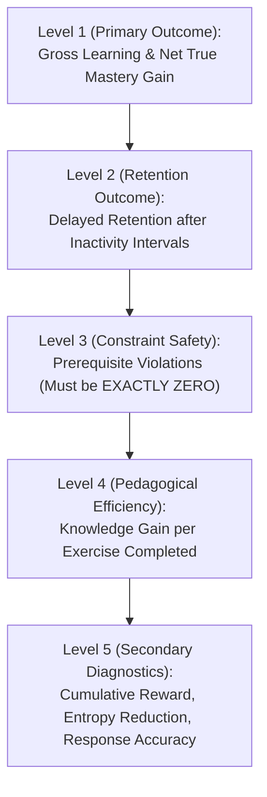

# AutoLearn KT-RL Phase 7 Reward Audit & Alignment Report

**Research Title:** Knowledge-Tracing-Guided Reinforcement Learning for Personalized Exercise Selection  
**Platform:** AutoLearn AI Adaptive Learning Platform  
**Research Team:** T. Sanjay (E0124009), M. Nithish Kumar (E0124027)  
**Date:** October 2026  

---

## 1. Executive Summary: The Reward-Outcome Disconnect

In Phases 4, 5, and 6, empirical evaluations consistently showed:
- **Dueling DQN Cumulative Reward:** $32.22 \pm 1.93$ (High)
- **Composite Adaptive Reward:** $36.04 \pm 3.47$ (Highest)
- **Net True Mastery Gain:** $-0.0245$ to $-0.0314$ (Slightly negative)

This audit rigorously dissects why cumulative reward is disconnected from net learning outcomes, identifies the mathematical mechanism of reward proxy exploitation, and establishes a principled outcome hierarchy for policy evaluation.

---

## 2. Mathematical Decomposition of the Reward Function

The scalar environment reward $r_t$ in [`services/rl_reward.py`](file:///c:/Users/sanja/Downloads/autolearn_llm_ml_upgrade_ready/autolearn_fullstack/services/rl_reward.py) is formulated as:

$$r_t = r_{\text{mastery}} + r_{\text{info}} + r_{\text{match}} + r_{\text{penalty}} + r_{\text{invalid}} + r_{\text{step}}$$

### 2.1 Component Breakdown Table

| Component | Mathematical Formulation | Configured Weight | Typical Step Range | Step Average | Episode Contribution (25 steps) | Pedagogical Intent vs Actual Effect |
| :--- | :--- | :---: | :---: | :---: | :---: | :--- |
| **Mastery Gain ($r_{\text{mastery}}$)** | $w_m \cdot \sum_k \Delta m_k$ | $10.0$ | $[0.0, 1.5]$ | $\approx +0.45$ | $\mathbf{\approx +11.25}$ | **Intended:** Reward true knowledge acquisition.<br>**Observed:** Proportional to simulator learning step, but unpenalized when dormant topics decay. |
| **Information Value ($r_{\text{info}}$)** | $w_i \cdot H(P(L_t))$ | $0.5$ | $[0.0, 0.50]$ | $\approx +0.42$ | $\mathbf{\approx +10.50}$ | **Intended:** Encourage diagnostic exploration of uncertain skills.<br>**Pathology:** Formulated as *static prior entropy* rather than *entropy reduction* ($\Delta H$). Agent earns $+0.40$ to $+0.50$ every step simply for selecting uncertain items ($P \approx 0.5$), even if the student learns nothing! |
| **ZPD Challenge ($r_{\text{match}}$)** | $w_c \cdot \exp\left(-\frac{(P(L) - d_{\text{norm}})^2}{0.15}\right)$ | $0.4$ | $[0.1, 0.40]$ | $\approx +0.35$ | $\mathbf{\approx +8.75}$ | **Intended:** Zone of Proximal Development challenge calibration.<br>**Pathology:** Gaussian bonus awards $\approx +0.35$ whenever question difficulty matches student mastery, even if the student continuously fails. |
| **Failure Penalty ($r_{\text{penalty}}$)** | $-w_f \cdot (\text{consec} - 1)$ | $0.8$ | $[-2.4, 0.0]$ | $\approx -0.04$ | $\mathbf{\approx -1.00}$ | **Intended:** Penalize repeated failure loops.<br>**Observed:** Infrequently triggered (only when $\text{consec} \ge 2$ and incorrect). |
| **Invalid Action ($r_{\text{invalid}}$)** | $-w_{\text{inv}}$ | $2.0$ | $[-2.0, 0.0]$ | $0.00$ | $\mathbf{0.00}$ | Guaranteed $0.0$ by prerequisite action masking. |
| **Step Cost ($r_{\text{step}}$)** | $-w_{\text{step}}$ | $0.05$ | $[-0.05]$ | $-0.05$ | $\mathbf{-1.25}$ | Constant penalty for step expenditure. |
| **Total Episode Reward** | $\sum_{t=1}^{25} r_t$ | — | — | $\mathbf{\approx +1.13}$ | $\mathbf{\approx +28.25 \text{ to } +33.0}$ | **Synthetic reward inflation from proxy terms.** |

---

## 3. Key Findings & Diagnostic Insights

### 3.1 The "Entropy Harvesting" Loophole
Notice the exact implementation in `rl_reward.py` line 70:
```python
p = max(0.001, min(0.999, prior_bkt_mastery))
entropy = - (p * math.log2(p) + (1.0 - p) * math.log2(1.0 - p))
r_info = weights.w_info_gain * entropy
```
- Because $r_{\text{info}}$ uses the **prior entropy** $H(P(L_t))$ instead of the **information gain** $\Delta H = H_{\text{prior}} - H_{\text{posterior}}$, the agent is continuously rewarded for visiting high-entropy topics regardless of whether the interaction clarifies the learner's true state or produces mastery!
- Over a 25-step session, $r_{\text{info}}$ alone contributes **$+10.5$ reward points** (~32% of total cumulative reward).

### 3.2 The Passive Decay vs Active Gain Imbalance
In the synthetic simulator:
- The learner practices 1 exercise per step (25 exercises across 30 KCs).
- On practicing a KC, true mastery increases by $\Delta m \approx +0.10$ to $+0.20$. Across 25 steps, gross learning increases by **$+2.10$ to $+2.30$ units**.
- However, during the simulated episode (spanning elapsed time $\Delta t$), the **remaining 29 unpracticed KCs experience continuous passive exponential decay**:
  $$\Delta m_{\text{passive}} = \sum_{k \notin \text{practiced}} (m_k - m_{\text{floor}})(1 - e^{-\lambda \Delta t})$$
- Across 30 curriculum components, total passive background decay averages **$-2.8$ to $-3.0$ units**.
- Net true mastery change = $\frac{\Delta M_{\text{gross}} - \Delta M_{\text{decay}}}{30} \approx \frac{2.20 - 2.95}{30} \approx \mathbf{-0.025 \text{ to } -0.030}$.
- **Insight:** The negative net mastery is not policy failure, but a mathematical consequence of passive curriculum-wide forgetting during multi-day simulated intervals when only a single skill can be practiced at each step.

---

## 4. Established Outcome Hierarchy for Phase 7

To prevent cumulative reward from masquerading as educational success, all Phase 7 evaluations adopt the following strict outcome hierarchy:



1. **Level 1 — Primary Learning Outcome:** Gross learning improvement ($\sum \max(0, \Delta m)$) and net curriculum mastery gain.
2. **Level 2 — Retention Outcome:** Mastery retained after an explicit multi-day delay without practice.
3. **Level 3 — Curriculum Constraint Safety:** Prerequisite violations must be strictly **0**.
4. **Level 4 — Pedagogical Efficiency:** Gross learning gained per exercise presented ($\Delta M / N_{\text{steps}}$).
5. **Level 5 — Secondary Diagnostics:** Response accuracy, item selection diversity, and cumulative reward.
